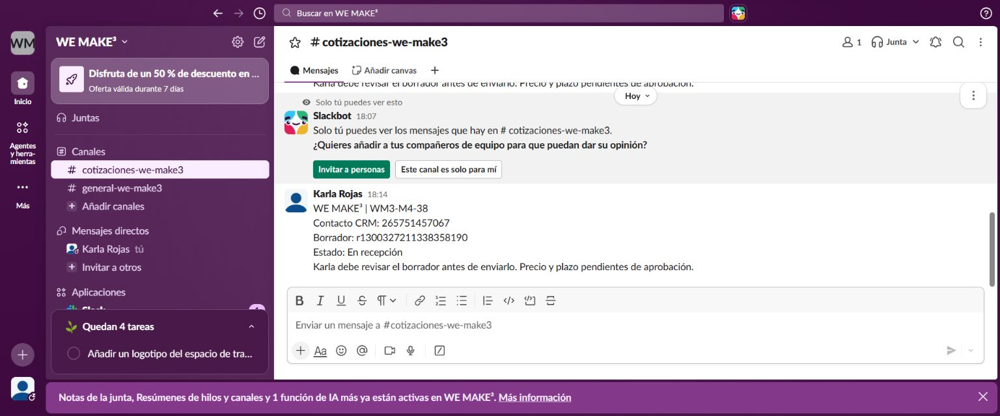

# WE MAKE³ — evidencia de la preentrega 4

El 26 de noviembre de 2026 completé tres pruebas manuales del workflow M4 con correos internos de la cuenta del negocio. El Manager tiene 50 nodos y se mantuvo inactivo; las ejecuciones se iniciaron manualmente desde n8n con el filtro `[WM3-M4]`.

## Conexiones reales

| Conexión | Cuenta o destino | Evidencia observada |
|---|---|---|
| HubSpot account | WE MAKE³, portal `52375701` | OAuth2 conectado; creación y reutilización del contacto en las pruebas 1 y 2 |
| Gmail account | wemake3.chile@gmail.com | OAuth2 conectado; lectura de los mensajes de prueba y creación de dos borradores |
| Slack account | WE MAKE³, canal `cotizaciones-we-make3` (`C0CN4S53GQ0`) | OAuth2 conectado como usuario; avisos visibles de las ejecuciones 36 y 38 |

Gmail tuvo un error 403 durante la preparación. Reconecté la credencial y repetí la consulta antes de las pruebas que se detallan aquí. Los permisos aceptados y su alcance están descritos en [README_M4.md](README_M4.md).

## Prueba 1 — contacto nuevo y solicitud de cotización

Envié un correo interno con asunto de prueba 01 y el prefijo `[WM3-M4]`, desde y hacia `wemake3.chile@gmail.com`. El mensaje identificaba una consulta ficticia de Cliente Prueba M4 por 2 lámparas de unos 12 cm, color celeste y base redonda.

| Dato | Resultado observado |
|---|---|
| Manager | Ejecución `36`, Success, 1 min 6,38 s |
| Especialista Registro | Ejecución `37` |
| Solicitud en planilla | `WM3-37`, Pendiente de revisión |
| Contacto nuevo en HubSpot | `265751457067` |
| Borrador creado en Gmail | `r-6743414608417606828` |
| Aviso de Slack | Referencia `WM3-M4-36`, con el contacto, borrador y estado |

El resultado dejó el caso pendiente de mi revisión de viabilidad, precio y plazo. No confirmó un pedido ni envió al cliente el borrador preparado.

## Prueba 2 — contacto existente

Envié un segundo correo interno con el prefijo `[WM3-M4]`, desde el mismo email. La consulta ficticia pedía orientación sobre una figura de mascota y especificaba que no se registrara una cotización nueva.

| Dato | Resultado observado |
|---|---|
| Manager | Ejecución `38`, Success; no se registró aquí la duración |
| Especialista | Ejecución `39` |
| Contacto reutilizado en HubSpot | `265751457067`, el mismo de la prueba 1 |
| Nuevo borrador en Gmail | `r1300327211338358190` |
| Aviso de Slack | Referencia `WM3-M4-38`, estado En recepción |
| Cotización nueva | No se registró una nueva en este caso |

La búsqueda anterior a la escritura reutilizó el contacto por email y no generó un segundo contacto para el mismo remitente. HubSpot muestra el email como identificación de ese contacto; no se afirma una carga automática de nombre y apellido.

## Prueba 3 — respuesta automática

Envié un tercer correo interno con el prefijo `[WM3-M4]` y `Auto-reply` en el asunto, identificado como prueba interna 03.

| Dato | Resultado observado |
|---|---|
| Resultado de la ejecución | Success, 7,109 s |
| ID de ejecución | No se capturó; no se le asigna uno por inferencia |
| Nodos ejecutados | Correo entrante → IF de respuesta automática → Ignorar correo automático |
| Estado de salida | `ignored` |
| Motivo | `AUTO_REPLY_FILTER` |
| ID del mensaje | `1a219b651e87cb35` |
| Efectos posteriores | No ejecutó IA, CRM, creación de borrador ni publicación en Slack |

## Datos de ejemplo y controles

Durante la revisión, la lista de HubSpot mostró tres contactos: Brian Halligan (Sample Contact), Maria Johnson (Sample Contact) y el email del negocio creado por el flujo. Los dos primeros son muestras del proveedor y no se usaron como destinatarios de pruebas. Los tres contactos de un CSV adicional preparado no se importaron, por lo que no se presenta esa carga como realizada.

| Criterio de la consigna | Evidencia de cumplimiento |
|---|---|
| IF inmediatamente después del correo entrante | La prueba Auto-reply se detuvo tras tres nodos, sin llegar al agente |
| Lookup anterior a Create | Pruebas 1 y 2, con el mismo ID de contacto `265751457067` |
| Gmail exclusivamente Create Draft | Dos IDs de borrador creados; el workflow M4 no contiene Gmail Send |
| Set que limpia el contenido antes del conector | El aviso observado en Slack contiene IDs, estado e instrucción de revisión, sin el correo completo ni adjuntos |

## Exportación y límites de la evidencia

Se prepararon la exportación real del Manager y las de sus dos especialistas. Se retiraron `pinData`, el identificador de la instancia y cualquier secreto de autenticación, conservando nodos, conexiones, parámetros y referencias de credenciales necesarias para la importación. Al usar otra instancia deben reasignarse las credenciales, las planillas, el canal y los dos subworkflows.

Los tres archivos se analizaron como JSON válido y se comprobaron sus referencias de grafo: Manager, 50 nodos; Registro, 6; Orientación, 4. Sus nodos y conexiones coinciden con las exportaciones reales de origen; la preparación del paquete no cambió la lógica ni volvió a ejecutar las pruebas del módulo 3.

El piloto procesa un correo por ejecución. No se probó el procesamiento simultáneo ni por lotes. El lookup evita duplicar contactos por email; no se implementó deduplicación de borradores y avisos por `messageId`. No se probaron caídas de proveedores ni los restantes patrones de correo automático mediante mensajes reales. Los resultados de esta evidencia corresponden únicamente a los tres casos descritos.

El workflow sigue inactivo. Precio, plazo y envío de la respuesta permanecen sujetos a revisión humana.
