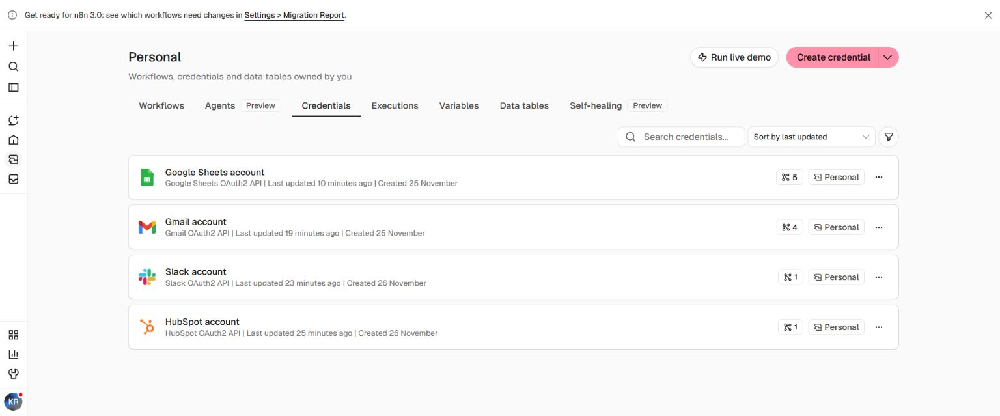

# WE MAKE³ — evidencia de la preentrega 4

El 26 de noviembre de 2026 completé tres pruebas manuales del workflow M4 con correos internos de la cuenta del negocio. El Manager tiene 50 nodos y se mantuvo inactivo; las ejecuciones se iniciaron manualmente desde n8n con el filtro `[WM3-M4]`.

## Conexiones reales

| Conexión | Cuenta o destino | Evidencia observada |
|---|---|---|
| HubSpot account | WE MAKE³, portal `52375701` | OAuth2 conectado; creación y reutilización del contacto en las pruebas 1 y 2 |
| Gmail account | wemake3.chile@gmail.com | OAuth2 conectado; lectura de los mensajes de prueba y creación de dos borradores |
| Slack account | WE MAKE³, canal `cotizaciones-we-make3` (`C0CN4S53GQ0`) | OAuth2 conectado como usuario; avisos visibles de las ejecuciones 36 y 38 |

Gmail tuvo un error 403 durante la preparación. Reconecté la credencial y repetí la consulta antes de las pruebas que se detallan aquí. Los permisos aceptados y su alcance están descritos en [README_M4.md](README_M4.md).

## Prueba 1 — contacto nuevo y solicitud de cotización

Envié un correo interno con asunto de prueba 01 y el prefijo `[WM3-M4]`, desde y hacia `wemake3.chile@gmail.com`. El mensaje identificaba una consulta ficticia de Cliente Prueba M4 por 2 lámparas de unos 12 cm, color celeste y base redonda.

| Dato | Resultado observado |
|---|---|
| Manager | Ejecución `36`, Success, 1 min 6,38 s |
| Especialista Registro | Ejecución `37` |
| Solicitud en planilla | `WM3-37`, Pendiente de revisión |
| Contacto nuevo en HubSpot | `265751457067` |
| Borrador creado en Gmail | `r-6743414608417606828` |
| Aviso de Slack | Referencia `WM3-M4-36`, con el contacto, borrador y estado |

El resultado dejó el caso pendiente de mi revisión de viabilidad, precio y plazo. No confirmó un pedido ni envió al cliente el borrador preparado.

## Prueba 2 — contacto existente

Envié un segundo correo interno con el prefijo `[WM3-M4]`, desde el mismo email. La consulta ficticia pedía orientación sobre una figura de mascota y especificaba que no se registrara una cotización nueva.

| Dato | Resultado observado |
|---|---|
| Manager | Ejecución `38`, Success; no se registró aquí la duración |
| Especialista | Ejecución `39` |
| Contacto reutilizado en HubSpot | `265751457067`, el mismo de la prueba 1 |
| Nuevo borrador en Gmail | `r1300327211338358190` |
| Aviso de Slack | Referencia `WM3-M4-38`, estado En recepción |
| Cotización nueva | No se registró una nueva en este caso |

La búsqueda anterior a la escritura reutilizó el contacto por email y no generó un segundo contacto para el mismo remitente. HubSpot muestra el email como identificación de ese contacto; no se afirma una carga automática de nombre y apellido.

## Prueba 3 — respuesta automática

Envié un tercer correo interno con el prefijo `[WM3-M4]` y `Auto-reply` en el asunto, identificado como prueba interna 03.

| Dato | Resultado observado |
|---|---|
| Resultado de la ejecución | Success, 7,109 s |
| ID de ejecución | No se capturó; no se le asigna uno por inferencia |
| Nodos ejecutados | Correo entrante → IF de respuesta automática → Ignorar correo automático |
| Estado de salida | `ignored` |
| Motivo | `AUTO_REPLY_FILTER` |
| ID del mensaje | `1a219b651e87cb35` |
| Efectos posteriores | No ejecutó IA, CRM, creación de borrador ni publicación en Slack |

## Datos de ejemplo y controles

Durante la revisión, la lista de HubSpot mostró tres contactos: Brian Halligan (Sample Contact), Maria Johnson (Sample Contact) y el email del negocio creado por el flujo. Los dos primeros son muestras del proveedor y no se usaron como destinatarios de pruebas. Los tres contactos de un CSV adicional preparado no se importaron, por lo que no se presenta esa carga como realizada.

| Criterio de la consigna | Evidencia de cumplimiento |
|---|---|
| IF inmediatamente después del correo entrante | La prueba Auto-reply se detuvo tras tres nodos, sin llegar al agente |
| Lookup anterior a Create | Pruebas 1 y 2, con el mismo ID de contacto `265751457067` |
| Gmail exclusivamente Create Draft | Dos IDs de borrador creados; el workflow M4 no contiene Gmail Send |
| Set que limpia el contenido antes del conector | El aviso observado en Slack contiene IDs, estado e instrucción de revisión, sin el correo completo ni adjuntos |

## Exportación y límites de la evidencia

Se prepararon la exportación real del Manager y las de sus dos especialistas. Se retiraron `pinData`, el identificador de la instancia y cualquier secreto de autenticación, conservando nodos, conexiones, parámetros y referencias de credenciales necesarias para la importación. Al usar otra instancia deben reasignarse las credenciales, las planillas, el canal y los dos subworkflows.

Los tres archivos se analizaron como JSON válido y se comprobaron sus referencias de grafo: Manager, 50 nodos; Registro, 6; Orientación, 4. Sus nodos y conexiones coinciden con las exportaciones reales de origen; la preparación del paquete no cambió la lógica ni volvió a ejecutar las pruebas del módulo 3.

El piloto procesa un correo por ejecución. No se probó el procesamiento simultáneo ni por lotes. El lookup evita duplicar contactos por email; no se implementó deduplicación de borradores y avisos por `messageId`. No se probaron caídas de proveedores ni los restantes patrones de correo automático mediante mensajes reales. Los resultados de esta evidencia corresponden únicamente a los tres casos descritos.

El workflow sigue inactivo. Precio, plazo y envío de la respuesta permanecen sujetos a revisión humana.

## Revisión adicional del 27 de noviembre de 2026

Mantuve las pruebas anteriores con su fecha original. En esta revisión agregué las comprobaciones siguientes, separando lo observado en los servicios de las pruebas locales.

### Conectividad observada en n8n

| Conexión | Resultado observado el 27 de noviembre |
|---|---|
| Gmail account | `Account connected` |
| HubSpot account | `Account connected` |
| Slack account | Conectada como el usuario del espacio WE MAKE³ |
| Uso de las tres credenciales en HTTP Request | `Allowed HTTP Request Domains: None` |

El estado conectado no acredita por sí solo una nueva lectura de correo o la creación de otro borrador. La evidencia de lectura, borradores y avisos documentada antes corresponde a las ejecuciones del 26 de noviembre. Los alcances OAuth concedidos siguen siendo los descritos en el README; limitar los nodos y los destinos no reduce esos permisos por sí mismo.

### Importación del archivo publicado

Importé desde la URL pública de GitHub el archivo `checkpoint4_karla_rojas.json` en una copia independiente de revisión. El editor de n8n cargó el grafo de **50 nodos sin errores observables**. La copia quedó identificada como QA de importación del 27 de noviembre y sin publicar. El workflow original se conservó.

Después exporté esa copia y comparé sus nodos y conexiones con el archivo público. Coincidieron los 50 nodos funcionales, sus parámetros y referencias de credenciales, y el grafo completo. La copia quedó inactiva y **no se ejecutó**. Se renovaron los identificadores de nodos, las posiciones del lienzo y los identificadores de webhook; no se presentan como cambios de lógica.

La copia de QA no retuvo explícitamente `executionTimeout`, `callerPolicy`, `timeSavedMode` y `availableInMCP`. Por eso la prueba acredita importación del grafo, no identidad de todos los ajustes. Antes de ejecutar una copia importada hay que revisar estos valores del original:

| Ajuste del workflow original | Valor que debe revisarse al importar |
|---|---|
| `executionTimeout` | `180` segundos |
| `callerPolicy` | `workflowsFromSameOwner` |
| `timeSavedMode` | `fixed` |
| `availableInMCP` | `false` |

Esta comprobación verifica que el archivo publicado puede cargarse en n8n. No sustituye las pruebas de ejecución ni demuestra que las credenciales y las dependencias queden configuradas automáticamente en otra instancia.

### Tres contactos ficticios propios en HubSpot

Creé manualmente estos contactos con los datos del CSV preparado; no importé ese archivo.

| Contacto de prueba | Email ficticio | ID observado |
|---|---|---|
| Prueba M4 Lámparas | prueba-m4-lamparas@example.com | `265376033580` |
| Prueba M4 Figuras | prueba-m4-figuras@example.com | `265376033599` |
| Prueba M4 Repuestos | prueba-m4-repuestos@example.com | `265375643136` |

La lista mostró seis contactos en total: estos tres, los dos ejemplos de HubSpot y el contacto del negocio creado por el flujo. No envié correos a las tres direcciones ficticias. Esto amplía la preparación del CRM; no se presenta como una nueva ejecución automática del workflow.

### Matriz de validación local

| Grupo | Comprobaciones aprobadas |
|---|---:|
| Normalización de correo y contenido | 12 |
| Filtros automáticos en los dos puntos del flujo | 16 |
| Paquete exportado, grafos y referencias | 1 |
| **Subtotal local** | **29 de 29** |
| Comparación de nodos de la importación real | 1 |
| Comparación del grafo de la importación real | 1 |
| **Total de la revisión** | **31 de 31** |

Se comprobaron límites de cuerpo y asunto, texto vacío, remitentes múltiples o inválidos, eliminación de caracteres NUL, exclusión de adjuntos y binarios, limpieza de scripts en HTML y rechazo de múltiples correos en una ejecución. También se probaron Auto-reply, Out of office, Undeliverable, no-reply, Auto-Submitted y Precedence con entradas simuladas.

Las primeras 29 comprobaciones se ejecutaron localmente sobre las funciones y expresiones del archivo exportado. Las otras dos comparan el archivo descargado después de la importación observada en n8n. **No son 31 ejecuciones del workflow ni 31 pruebas de servicios externos.** El resultado conjunto fue PASS, sin fallos. Se mantienen los límites ya informados sobre reprocesamiento de `messageId`, concurrencia, lotes y caídas de proveedores.

### Tres pruebas reales nuevas con el Gmail del negocio

Comprobé en Gmail la cuenta **We Make3 — wemake3.chile@gmail.com**. Con autorización específica envié manualmente tres mensajes ficticios desde y hacia esa misma cuenta. La salida del workflow se mantuvo exclusivamente en borradores.

#### Caso 01 — registro con contacto existente

Asunto: `[WM3-M4] Revision 27nov2026 - correo 01 - WM3-REV-01`.

La consulta pedía registrar dos lámparas de unos 12 cm, color celeste y base redonda, sin confirmar precio ni plazo.

| Dato | Resultado observado |
|---|---|
| Manager | `41`, Succeeded; **33,133 s en el historial** |
| Solicitud registrada | `WM3-42` |
| Contacto reutilizado | `265751457067`; ya existía antes de esta regresión |
| Borrador | `r715386675662326933`, comprobado en Gmail del negocio |
| Destinatario del borrador | `wemake3.chile@gmail.com` |
| Aviso de Slack | `ok: true`, referencia `WM3-M4-41` |
| Canal y equipo | `C0CN4S53GQ0` y `T0CMA99J6Q2` |
| Referencia del mensaje de Slack | `1795798848.206179` |

El borrador dejó la solicitud pendiente de revisión de Karla y no confirmó pedido, precio ni fecha. `WM3-42` es el ID de solicitud observado; no se atribuye por inferencia un ID al especialista.

#### Caso 02 — orientación del mismo remitente

Asunto: `ORIENTAR: [WM3-M4] Revision 27nov2026 - correo 02 - WM3-REV-02`.

La consulta pedía orientación sobre antecedentes para una figura de mascota, sin registrar otra cotización.

| Dato | Resultado observado |
|---|---|
| Manager | `43`, Succeeded; **6,548 s en el historial** |
| Contacto reutilizado | `265751457067`, el mismo del caso 01 |
| Borrador | `r-679903766174226305`, comprobado en Gmail con el asunto del caso 02 |
| Contenido | Guía general para reunir antecedentes de cotización |
| Aviso de Slack | `ok: true`, referencia `WM3-M4-43`, estado En recepción |
| Canal y equipo | Los mismos del caso 01 |
| Referencia del mensaje de Slack | `1795799040.224919` |

El especialista de Orientación devuelve esa guía general mediante una ruta determinista.

#### Caso 03 — Out of office

Asunto: `[WM3-M4] Out of office - Revision 27nov2026 - correo 03 - WM3-REV-03`.

| Dato | Resultado observado |
|---|---|
| Manager | `45`, Succeeded; **558 ms en el historial** |
| Mensaje | `1a21df89039dca31` |
| From y To del disparador | Ambos de la cuenta WE MAKE³ |
| Recorrido | Correo entrante → IF de respuesta automática → Ignorar correo automático |
| Salida | `status: ignored`, `reason: AUTO_REPLY_FILTER` |
| Efectos posteriores | Sin IA, CRM, creación de borrador ni Slack |

La búsqueda final en Borradores con `Revision 27nov2026` mostró solo los casos 01 y 02. La cuenta tenía cuatro borradores: los dos anteriores y estos dos nuevos. Los tres mensajes de entrada fueron enviados manualmente como prueba; **la IA no envió respuestas**.

El historial mostró las ejecuciones 41, 43 y 45 como Succeeded, sin ejecuciones activas al terminar. Se usan las duraciones del historial; no las del editor, que incluían otros pasos de la prueba. El workflow original siguió inactivo y no se modificaron su lógica ni sus ajustes.

Esta revisión añadió Out of office real a Auto-reply del 26 de noviembre. Los restantes patrones se comprobaron localmente con entradas simuladas. Se mantienen los límites ya declarados sobre reprocesamiento de `messageId`, concurrencia, lotes, fallos de proveedores y permisos OAuth amplios.

