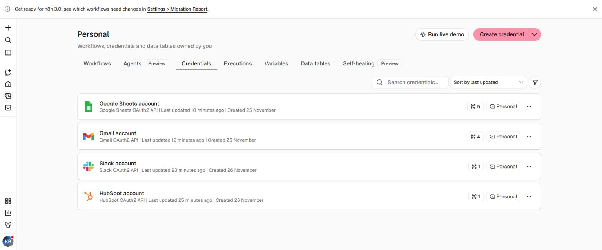

# WE MAKE³ · Cotizaciones automatizadas

**Karla Rojas · Coderhouse AI Automation Avanzado**

Estoy desarrollando este proyecto para organizar las solicitudes de cotización de WE MAKE³, mi emprendimiento de impresión 3D. El sistema reúne los antecedentes y prepara la respuesta; yo reviso la viabilidad, el precio y el plazo antes de confirmar algo al cliente.

## Preentrega 4 · Correo, CRM y avisos internos

El archivo principal es [checkpoint4_karla_rojas.json](checkpoint4_karla_rojas.json). Esta versión recibe un correo del piloto, consulta la memoria del caso, busca el contacto en HubSpot antes de crearlo, guarda un borrador en Gmail y deja un aviso en Slack.

- [Cómo funciona y cómo importarlo](README_M4.md).
- [Pruebas realizadas y límites observados](EVIDENCIA_M4.md).
- Dependencias: [Worker Registro con contexto](worker_registro_m3.json) y [Worker Orientación](worker_orientacion_m2.json).

La respuesta al cliente queda como **borrador para revisión humana**. El flujo principal no tiene un nodo Gmail Send. Los correos utilizados para probarlo fueron mensajes ficticios enviados manualmente desde y hacia la misma cuenta del negocio.

### Conexiones del entorno probado

Gmail cumple el rol de casilla de entrada y borradores; HubSpot, el de registro de contactos; Slack, el de avisos internos. Google Sheets conserva las solicitudes y la memoria trabajada en los módulos anteriores.

La captura muestra la lista de credenciales, sin contraseñas ni tokens. Las conexiones se comprobaron además en las ejecuciones documentadas. Al importar los archivos en otra instancia, hay que asignar credenciales propias y reasignar los dos subworkflows.

### Validación y alcance

Probé una solicitud nueva, otro correo de la misma dirección y una respuesta automática. Los dos primeros crearon borradores y avisos; el segundo reutilizó el contacto existente. El correo con asunto `Auto-reply` terminó en el filtro inicial, antes de la IA, el CRM y los borradores.

El checkpoint se exporta **inactivo**. El piloto filtra asuntos con `[WM3-M4]` y procesa un correo por consulta. La búsqueda evita duplicar contactos; todavía no hay una protección completa para impedir otro borrador o aviso si se reprocesa el mismo mensaje. No se realizaron pruebas de carga, concurrencia ni caídas del proveedor.

## Entregas anteriores

Las preentregas 1, 2 y 3 fueron enviadas a Coderhouse y figuran en corrección; ese estado no equivale a aprobación docente.

- Preentrega 1: [checkpoint1_karla_rojas.json](checkpoint1_karla_rojas.json), [documentación original](README_M1.md), [evidencias](EVIDENCIA_PRUEBAS.md) y [columnas de solicitudes](columnas_solicitudes.csv).
- Las preentregas 2 y 3 se presentaron mediante los PDF solicitados por la plataforma. La versión 4 amplía sus circuitos de especialistas y memoria.

El repositorio es público con mi autorización para compartir los entregables del curso. Los ejemplos son pruebas y no representan pedidos reales.
