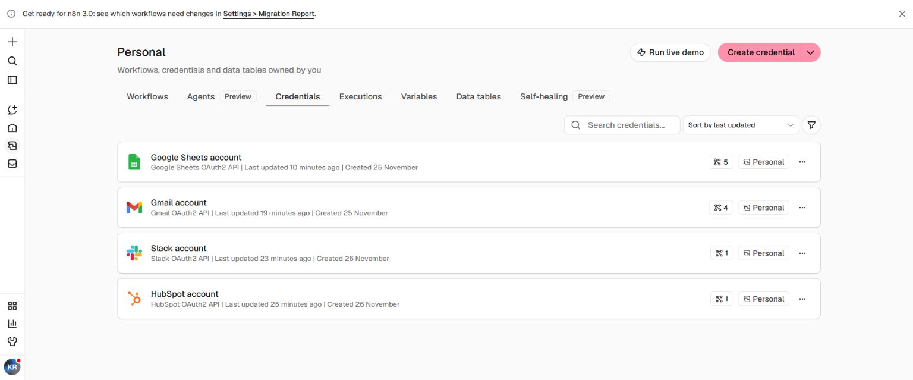
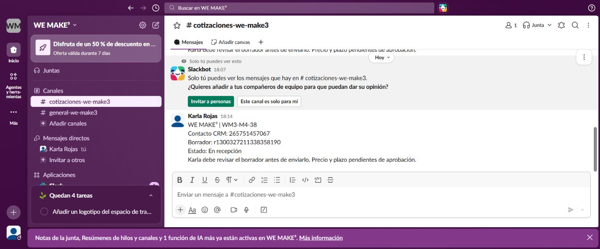

# WE MAKE³ — preentrega 4

Amplié mi proyecto de cotizaciones de WE MAKE³ para recibir consultas por Gmail, guardar el contacto en HubSpot y dejar un aviso en Slack. La respuesta al cliente queda como borrador para que yo la revise. El precio, la viabilidad y el plazo los reviso personalmente antes de confirmar un pedido.

Partí del sistema con memoria de la preentrega 3. Mantuve la lectura y actualización por sesión, el resumen de conversaciones largas y los especialistas de Registro y Orientación. A ese circuito le sumé las tres herramientas reales del negocio.

## Herramientas y conexiones

| Función | Herramienta | Conexión observada |
|---|---|---|
| Datos del cliente | HubSpot CRM gratuito | `HubSpot account`, conectado mediante OAuth2 |
| Correo y borradores | Gmail — wemake3.chile@gmail.com | `Gmail account`, conectado mediante OAuth2 |
| Avisos internos | Slack — WE MAKE³ / `cotizaciones-we-make3` | `Slack account`, conectado mediante OAuth2 como usuario |
| Memoria del caso | Google Sheets | Se conserva la conexión del módulo 3 |

## Cómo funciona

1. Gmail recibe un correo cuyo asunto contiene `[WM3-M4]`. El piloto trae como máximo un correo por consulta.
2. Un IF inmediatamente después del disparador revisa asunto y remitente. Si detecta una respuesta automática, corta el recorrido.
3. Obtengo el mensaje completo, reviso sus encabezados y conservo texto simple, sin adjuntos. Valido el correo del remitente antes de continuar.
4. Consulto la memoria de esa sesión y llamo al especialista. La sesión combina el remitente con el hilo de Gmail para mantener el contexto de la conversación.
5. Busco el contacto en HubSpot por su email exacto. Si existe, reutilizo ese contacto; si no existe, paso por la rama de creación.
6. Creo un borrador en el mismo hilo de Gmail y preparo un aviso breve para el canal interno de Slack.

## Controles de la consigna

| Control | Nodos | Comprobación realizada |
|---|---|---|
| IF contra respuestas automáticas | `¿Es una respuesta automática?`, inmediatamente después del disparador | El correo Auto-reply terminó en `ignored`, antes del agente y de las escrituras |
| Búsqueda antes de crear | `Buscar contacto antes de crear` y `¿Contacto ya existe?` | Dos correos del mismo remitente conservaron el mismo ID de contacto |
| Revisión humana | `Crear borrador sin enviar` — Gmail Draft / Create | Se crearon dos borradores y el flujo no los envió |
| Limpieza del contenido | `Preparar contacto y borrador` y `Preparar aviso mínimo al equipo` | El aviso de Slack contiene referencias, estado e instrucción de revisión; no la conversación completa |

El conector nativo de HubSpot usa **Create or Update / upsert** para escribir por email. Las ramas de contacto nuevo y existente usan esa operación después de la búsqueda. El registro de HubSpot guarda el email; el nombre y el detalle de la solicitud se conservan en la planilla y en la respuesta preparada.

Antes del CRM y del borrador dejo `from_email`, `subject`, `body_text`, la referencia de ejecución y el estado. El destinatario sale del remitente validado del correo original, no de una decisión del modelo. Antes de Slack reduzco el contenido al ID de contacto, ID de borrador, estado y referencia de ejecución.

## Permisos concedidos

Las conexiones gestionadas solicitaron permisos más amplios que las operaciones de este piloto. Los revisé antes de aceptarlos y uso una cuenta separada para el negocio.

| Conexión | Alcance aceptado | Uso en el workflow |
|---|---|---|
| HubSpot | 13 permisos obligatorios sobre contactos, empresas, negocios, listas, propiedades o esquemas, formularios, responsables y tickets; incluyen escritura y eliminación en varios objetos | Buscar y crear o actualizar contactos por email |
| Gmail | Leer, redactar y enviar correos, con gestión de etiquetas y movimientos a papelera o spam. No seleccioné eliminación permanente ni acceso continuado. Google mostró vencimiento el 25 de mayo de 2027 | Leer el correo del piloto y crear borradores |
| Slack | Conexión de usuario con lectura y búsqueda de canales, mensajes directos, archivos y miembros; envío de mensajes y gestión de canales, archivos, grupos, perfil, reacciones y favoritos | Publicar el aviso en el canal fijo de cotizaciones |

El destino y las operaciones están limitados en los nodos, pero eso no reduce por sí mismo los permisos de la credencial. La captura no muestra tokens, contraseñas ni códigos de acceso.

## Pruebas realizadas

El 26 de noviembre de 2026 probé tres correos internos enviados desde y hacia el Gmail del negocio, con consultas ficticias. Los resultados completos y sus referencias están en [EVIDENCIA_M4.md](EVIDENCIA_M4.md).

| Caso | Resultado observado |
|---|---|
| Consulta de un contacto nuevo — ejecución 36 | Registró la solicitud `WM3-37` pendiente de revisión, creó el contacto, un borrador y el aviso interno |
| Otro correo del mismo remitente — ejecución 38 | Reutilizó el mismo contacto, creó otro borrador y publicó el aviso; no registró una cotización nueva |
| Auto-reply | Solo ejecutó el disparador, el IF inicial y el nodo de descarte; no llamó al agente, CRM, borrador ni Slack |

## Archivos e importación

- [checkpoint4_karla_rojas.json](checkpoint4_karla_rojas.json): Manager con las integraciones, exportado desde n8n; 50 nodos.
- [worker_registro_m3.json](worker_registro_m3.json): especialista de registro con contexto.
- [worker_orientacion_m2.json](worker_orientacion_m2.json): especialista de orientación.

Para usarlo en otra instancia:

1. Importar primero los dos especialistas y después el Manager.
2. En `Ejecutar Registro` y `Ejecutar Orientación`, seleccionar los workflows importados en esa instancia.
3. Reasignar las credenciales propias de Gmail, HubSpot y Slack. También seleccionar la conexión de Google Sheets y el modelo de IA que utilizan la memoria, el resumidor y los especialistas.
4. Seleccionar las planillas del proyecto y el canal de Slack propio. Mantener el límite de un correo y el filtro de asunto del piloto durante la revisión.
5. Ejecutar una prueba interna y revisar sus resultados antes de activar el flujo.

Los archivos mantienen las referencias de configuración necesarias para importar, pero no incluyen secretos. No publiqué datos de entrada fijados en `pinData` ni el identificador de la instancia.

## Alcance y límites

Dejé el workflow inactivo y con el filtro `[WM3-M4]`. Las pruebas reales usaron únicamente el correo del negocio; no se enviaron respuestas a clientes. Los tres correos internos fueron escenarios de prueba enviados manualmente, mientras que la salida automática del workflow se mantuvo en borradores.

El control de duplicados cubre los contactos del CRM. Repetir el mismo `messageId` todavía puede generar otro borrador o aviso. No probé concurrencia, lotes de correos ni caídas de proveedores. El filtro también contempla otros asuntos y remitentes automáticos, pero la prueba real de descarte realizada fue Auto-reply.

## Revisión adicional del 27 de noviembre de 2026

Volví a revisar la entrega contra la consigna. Comprobé en n8n el estado conectado de Gmail, HubSpot y Slack. Los tres conectores mantienen `Allowed HTTP Request Domains: None`; esto no reemplaza la revisión de los permisos OAuth amplios que expliqué antes.

Probé la importación del JSON desde su URL pública de GitHub en una copia separada: el grafo de 50 nodos cargó sin errores observables. Dejé esa copia de revisión sin publicar y conservé el workflow original. Esta prueba comprueba la importación; no equivale a ejecutar todas sus ramas ni a probar credenciales en otra instancia.

Al comparar la exportación de esa copia con el archivo público, coincidieron los 50 nodos funcionales, sus parámetros y credenciales, y las conexiones del grafo. n8n renovó identificadores y posiciones del lienzo. La copia no retuvo explícitamente cuatro ajustes del workflow: `executionTimeout`, `callerPolicy`, `timeSavedMode` y `availableInMCP`. Antes de ejecutar una importación, hay que revisar sus ajustes y confirmar los valores del original: 180 segundos de tiempo máximo, llamadas desde workflows del mismo propietario, ahorro de tiempo en modo fijo y disponibilidad en MCP desactivada. No se afirma que todos los ajustes se importen idénticos.

También creé manualmente tres contactos ficticios propios en HubSpot para completar la preparación del CRM. Usé los datos del CSV de prueba que había preparado, sin importar el archivo. No envié correos a esas direcciones.

La revisión reunió **31 comprobaciones aprobadas, sin fallos**: 29 comprobaciones locales del paquete, los filtros y la normalización del correo, más dos comparaciones del archivo importado realmente en n8n. Incluyen asuntos automáticos, remitentes inválidos o múltiples, texto vacío, límites de tamaño y exclusión de adjuntos y objetos binarios. Las comprobaciones locales no consultan Gmail, HubSpot ni Slack y no acreditan nuevas ejecuciones de esos servicios.

Las pruebas de correo, borradores y avisos del 26 de noviembre conservan su fecha y sus resultados originales. Las verificaciones adicionales de hoy se detallan por separado en [EVIDENCIA_M4.md](EVIDENCIA_M4.md).

### Tres pruebas reales nuevas de Gmail del negocio

Con autorización para probar únicamente **wemake3.chile@gmail.com**, envié manualmente tres mensajes ficticios desde y hacia esa misma cuenta. Comprobé la cuenta en Gmail, el historial de n8n y los borradores de esa casilla.

| Caso del 27 de noviembre | Resultado observado |
|---|---|
| Registro de dos lámparas — Manager 41 | Solicitud `WM3-42`, contacto existente reutilizado, borrador y aviso; viabilidad, precio y plazo pendientes de revisión |
| Orientación — Manager 43 | Mismo contacto, otro borrador con una guía general para reunir antecedentes y aviso, estado En recepción |
| Out of office — Manager 45 | Solo disparador, IF inicial y descarte; salida `ignored`, sin IA, CRM, borrador ni Slack |

Las tres ejecuciones fueron Succeeded. Sus duraciones en el historial fueron 33,133 s, 6,548 s y 558 ms, respectivamente. No se mezclan con los tiempos del editor, que incluyen otros pasos de la prueba.

La búsqueda final en Borradores de Gmail mostró exactamente los casos 01 y 02. Los tres mensajes de entrada fueron enviados manualmente para probar el circuito; **la IA no envió respuestas**. El workflow original siguió inactivo y sin ejecuciones activas al terminar.

La prueba de contacto nuevo sigue siendo la del 26 de noviembre: en la regresión del 27 se reutilizó el contacto del negocio. Esta revisión añadió Out of office real a la prueba anterior de Auto-reply. Se mantienen los límites documentados sobre otros patrones, reprocesamiento por `messageId`, concurrencia, lotes y caídas de proveedores.

